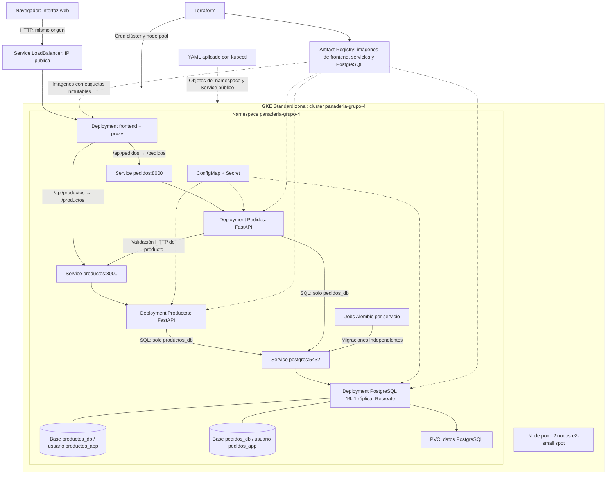

# Arquitectura propuesta

Diseño propio de Fase 1 que representa la arquitectura objetivo. En Fase 2 se agregaron las bases de código de ambos servicios y la configuración local de PostgreSQL; su ejecución aún no se ha verificado. Los componentes de GKE no están desplegados.

El Service público también pertenece al namespace del equipo; se dibuja junto al navegador para destacar el acceso externo. Terraform declara GKE y Artifact Registry; no administra objetos Kubernetes. El node pool tiene dos nodos `e2-small` spot. La ubicación y el proyecto de Google Cloud se parametrizarán cuando se proporcionen.

## Acceso y comunicación

El frontend sirve la interfaz y actúa como proxy del mismo origen. Conserva método, cuerpo, query string y estado HTTP al dirigir `/api/productos` y sus subrutas a `http://productos:8000/productos`, y `/api/pedidos` y sus subrutas a `http://pedidos:8000/pedidos`. La eliminación del prefijo `/api` debe implementarse explícitamente. Productos, Pedidos y PostgreSQL usan Services internos `ClusterIP`.

El navegador solo consume el origen público; los DNS `productos`, `pedidos` y `postgres` son para contenedores dentro del namespace. Pedidos usa `PRODUCTOS_BASE_URL=http://productos:8000`. No se necesitan IPs de pods ni CORS para esta integración del mismo origen. HTTP es el acceso inicial propuesto; dominio y TLS no se han configurado.

## Persistencia y propiedad

Un motor PostgreSQL 16 aloja dos bases lógicas con usuarios separados y permisos restringidos a su base. Productos es propietario de sus tablas y migraciones; Pedidos es propietario de las suyas. No existen consultas entre bases ni claves foráneas entre servicios. Los pedidos guardan nombre y precio históricos y pueden consultarse aunque Productos esté caído o el producto haya sido eliminado.

PostgreSQL usa un PVC, una réplica y estrategia `Recreate`. El volumen persiste frente a recreaciones de pods; no sustituye un respaldo ni garantiza disponibilidad ante fallos. Con nodos spot puede haber interrupciones. Los Jobs Alembic se ejecutan como paso explícito antes de las réplicas web, nunca como migración concurrente en cada arranque.

Las imágenes de todos los componentes, incluida PostgreSQL, deben alojarse en Artifact Registry. ConfigMap contendrá configuración no sensible; Secret contendrá credenciales suministradas por mecanismos seguros. No se versionan valores reales. Cada servicio tendrá su propio proyecto Python 3.12, lockfile y Dockerfile, sin paquetes internos compartidos que impidan construirlo independientemente.

Compose reproducirá localmente los DNS de servicios y la separación de bases con un volumen persistente. Las rutas de salud y su semántica se definen en el [contrato](contrato-api.md).

## Equipo y requisitos pendientes

| Dato | Estado |
| --- | --- |
| Identificador del equipo | Grupo 4 |
| Nombre del equipo | Power Rangers |
| Identificador técnico propuesto | `grupo-4`; clúster y namespace previstos: `panaderia-grupo-4` |
| Nombres de integrantes | Registrados en la tabla siguiente |
| Carnés de integrantes | `1199923`, `1280423`, `1040023`, `1053223`, `1333123`; conservar como texto |
| Proyecto y zona de Google Cloud | Pendientes de definir antes de infraestructura |

Integrantes y asociaciones proporcionados por el usuario; se conserva la escritura de los nombres recibidos:

| Nombre | Carné |
| --- | --- |
| Hector Flores | `1199923` |
| Joaquin Choc | `1280423` |
| Daniel Diaz | `1040023` |
| Jose Enriquez | `1053223` |
| Sofia Singüenza | `1333123` |

El equipo es **Grupo 4 — Power Rangers**, según lo proporcionado por el usuario. El identificador técnico propuesto incorpora el número del grupo en los nombres del clúster y namespace; estos recursos aún no existen. El proyecto exige almacenar los carnés reales en la base y mostrarlos en el frontend; su tabla, servicio propietario y mecanismo de consulta se definirán al abordar esa integración. Por ahora solo están documentados, sin persistencia en base de datos ni visualización en una interfaz. No forman parte de los cuerpos CRUD de Producto o Pedido.

La estimación de costos y alerta de presupuesto preceden cualquier despliegue. La Fase 1 no despliega ni publica recursos. Siguen pendientes implementación, pruebas con PostgreSQL, frontend, infraestructura real, evidencias A–G, historial de commits requerido, defensa y destrucción autorizada después de la defensa.
